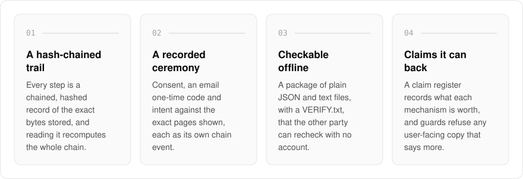
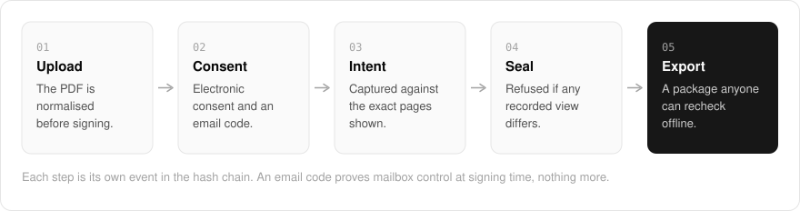

  <picture>
    <source media="(prefers-color-scheme: dark)" srcset=".github/assets/hero-dark.png">
    
  </picture>

<h1 align="center">sign.me.at</h1>

<strong>Signing that leaves evidence you can recheck without the service.</strong>

  
  
  
  

  <a href="#features">Features</a> ·
  <a href="#how-it-works">How it works</a> ·
  <a href="#screenshots">Screenshots</a> ·
  <a href="#built-with">Built with</a>

Anyone can render a name onto a PDF, and most e-signature evidence only exists for as long as the vendor's servers do. I built sign.me.at for electronic signatures with a defensible trail: every step of a signing is recorded as a chained, hashed record of the exact bytes, then exported as a folder of plain JSON and text files the other party can verify without an account and without my service running. Today you can sign your own PDF and check a package someone handed you; sending a document to other signers is not open to the public yet, and nothing here is legal advice.

  <picture>
    <source media="(prefers-color-scheme: dark)" srcset=".github/assets/overview-dark.svg">
    
  </picture>

## Why sign.me.at

| The usual e-signature | sign.me.at |
| --- | --- |
| A picture of a name on a PDF | A hash-chained record of every step, over the exact bytes stored |
| The proof lives on the vendor's servers | A package of plain files the other party can recheck offline |
| Copy that implies more than the mechanism proves | A claim register, and guards that refuse copy that overstates it |
| Seals whatever document is in front of it | Refuses to seal if the bytes differ from any signer's recorded view |

## Features

- **Self-sign and verify**: upload a PDF, type your name, and get it back sealed with a hash-chained record of what you signed and when. A separate page checks a verification package someone handed you, with no account.
- **Hash-chained audit trail**: every envelope opens with a salted genesis row, each append hashes the bytes as stored, and reading verifies by recomputing the whole chain.
- **A recorded signing ceremony**: consent to transact electronically, an email one-time code, and intent captured against the exact page images the signer was shown, each as its own chain event.
- **Portable verification package**: one export of published-format files (audit chain, manifests, a human-readable certificate and a `VERIFY.txt` with the recomputation procedure) that a counterparty can check offline.
- **Recipient roles**: five recipient roles produce five distinct chain events, so an approval, a read receipt and a signature stay distinguishable.
- **Honest claims by construction**: a claim register records what each mechanism is actually worth, and guards refuse user-facing copy that overstates it. Email one-time codes prove mailbox control at signing time, nothing more.
- **Seal that aborts rather than degrades**: sealing checks the document bytes against every recorded signer view and refuses on mismatch.
- **Privacy in the package**: portable packages carry digests instead of cleartext personal data; cleartext evidence lives only in an audited export.
- **Abuse caps on outbound invites**: sends, envelope creations and recipients are capped, and a new account's first delivery is held until it verifies its own address.

## How it works

  <picture>
    <source media="(prefers-color-scheme: dark)" srcset=".github/assets/flow-dark.svg">
    
  </picture>

The PDF is normalised first, and the signer's intent is captured against the exact page images they were shown. Consent, the one-time code and that intent are each appended to a hash chain over the exact bytes stored, and sealing refuses if the document no longer matches what a signer saw. The export is a folder of plain files with a `VERIFY.txt` that explains how to recompute the chain, so the evidence outlives the service that issued it.

## Screenshots

<table>
  <tr>
    <td width="50%"><picture><source media="(prefers-color-scheme: dark)" srcset=".github/assets/hero-dark.png"></picture> The landing page: what Sign records, with a status panel of what is usable today.</td>
    <td width="50%"><picture><source media="(prefers-color-scheme: dark)" srcset=".github/assets/self-sign-dark.png"></picture> Self-sign: upload a PDF, type your name, and get it back sealed with a hash-chained record.</td>
  </tr>
</table>

## Built with

  
  
  
  
  
  

- Next.js 16 (App Router), React 19, TypeScript
- Tailwind CSS 4
- Drizzle ORM + Postgres
- Better Auth
- oRPC + TanStack Query
- LibPDF for PDF handling

## Part of the me.at family

sign.me.at is one of my [`*.me.at`](https://me.at) apps. They share one design system, account, and app shell. Development happens in a private monorepo; this repository is the project's public-facing home.

## License

Source-available. See [LICENSE](LICENSE).
