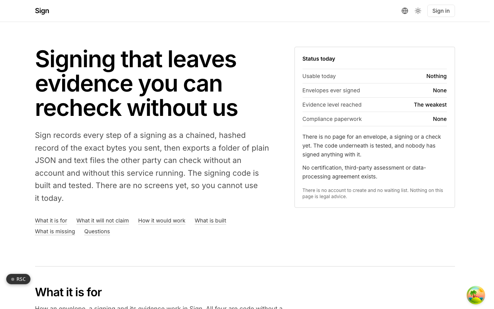
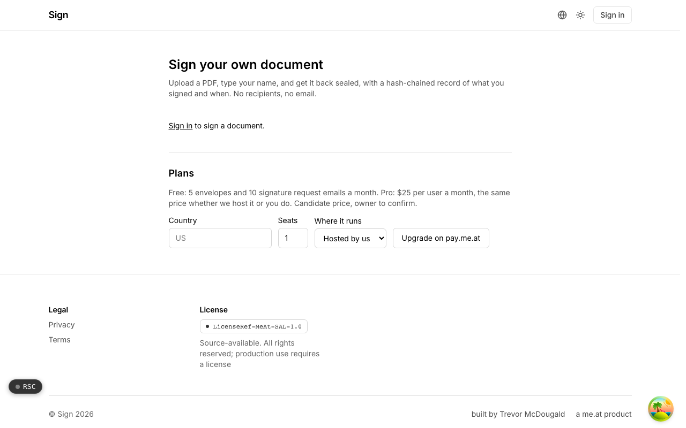

  <picture>
    <source media="(prefers-color-scheme: dark)" srcset=".github/assets/hero-dark.png">
    
  </picture>

# sign.me.at

Signing that leaves evidence you can recheck without us.

sign.me.at is electronic signatures with a defensible trail: reusable templates, per-signer audit records and cryptographic timestamps, not a picture of a name. Every step of a signing is recorded as a chained, hashed record of the exact bytes sent, then exported as a folder of plain JSON and text files the other party can verify without an account and without this service running. The signing and evidence code is built and tested; the signing screens are not open to the public yet, and nothing here is legal advice.

## Features

- **Hash-chained audit trail**: every envelope opens with a salted genesis row, each append hashes the bytes as stored, and reading verifies by recomputing the whole chain.
- **A recorded signing ceremony**: consent to transact electronically, an email one-time code, and intent captured against the exact page images the signer was shown, each as its own chain event.
- **Portable verification package**: one export of published-format files (audit chain, manifests, a human-readable certificate and a `VERIFY.txt` with the recomputation procedure) that a counterparty can check offline.
- **Recipient roles**: five recipient roles produce five distinct chain events, so an approval, a read receipt and a signature stay distinguishable.
- **Honest claims by construction**: a claim register records what each mechanism is actually worth, and guards refuse user-facing copy that overstates it. Email one-time codes prove mailbox control at signing time, nothing more.
- **Seal that aborts rather than degrades**: sealing checks the document bytes against every recorded signer view and refuses on mismatch.
- **Privacy in the package**: portable packages carry digests instead of cleartext personal data; cleartext evidence lives only in an audited export.
- **Abuse caps on outbound invites**: sends, envelope creations and recipients are capped, and a new account's first delivery is held until it verifies its own address.

## Screenshots

<table>
  <tr>
    <td width="50%"><picture><source media="(prefers-color-scheme: dark)" srcset=".github/assets/self-sign-dark.png"></picture> Self-sign: upload a PDF, type your name, and get it back sealed with a hash-chained record</td>
  </tr>
</table>

## Built with

- Next.js 16 (App Router), React 19, TypeScript
- Tailwind CSS 4
- Drizzle ORM + Postgres
- Better Auth
- oRPC + TanStack Query
- LibPDF for PDF handling

## Part of the me.at family

sign.me.at is one of my [`*.me.at`](https://me.at) apps. They share one design system, account, and app shell. Development happens in a private monorepo; this repository is the project's public-facing home.

## License

See [LICENSE](LICENSE).
